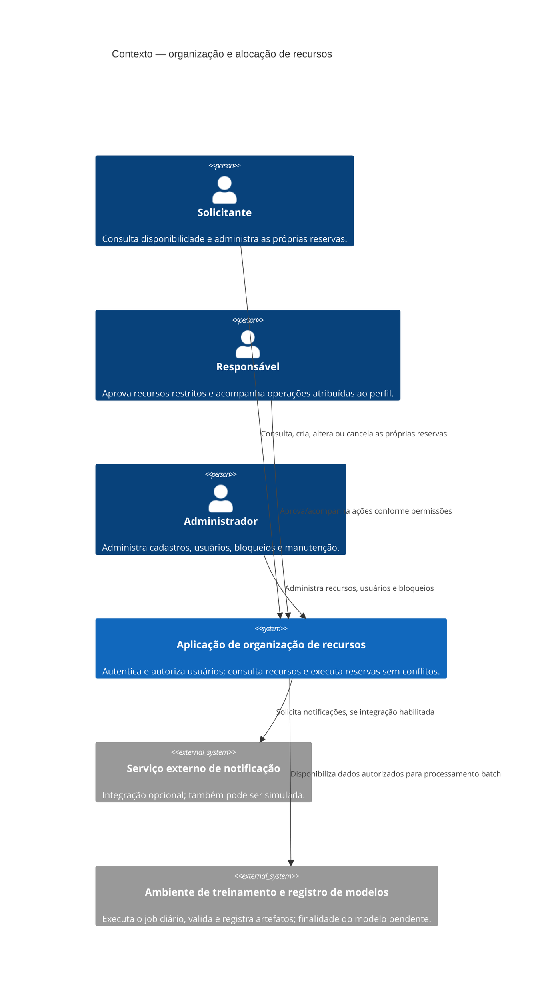
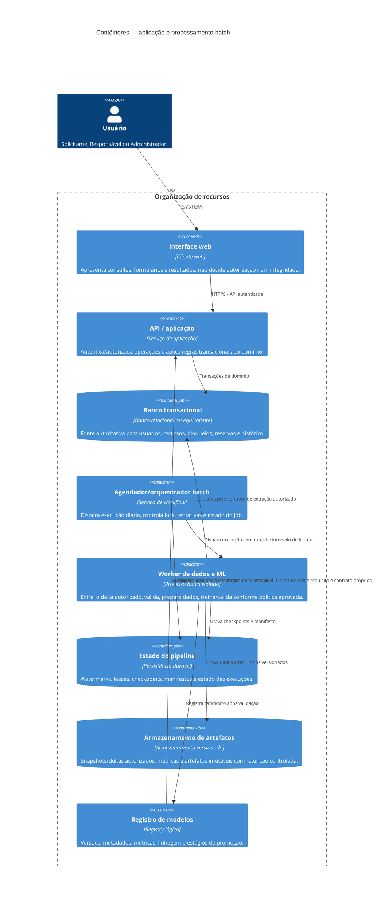
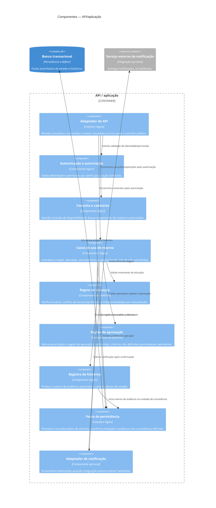

# Complemento de arquitetura — proposta para aplicação e pipeline de ML

> **Status: proposta não normativa.** Este documento complementa [arquitetura.md](./arquitetura.md), sem alterá-lo nem substituir as fontes de requisitos. Decisões abaixo são recomendações sujeitas à validação dos stakeholders. O pipeline diário de ML veio da solicitação desta atividade; não é requisito confirmado no PRD ou na especificação. Nenhuma tecnologia, volume, SLA, objetivo do modelo ou finalidade de tratamento de dados é presumido.

## 1. Base, escopo e leitura dos requisitos

### Fatos utilizados

- A aplicação atende Solicitantes, Responsáveis e Administradores; autenticação e autorização por perfil são necessárias.
- A alocação deve impedir sobreposição de recursos e professores, inclusive em solicitações concorrentes, e recursos em manutenção não podem ser reservados.
- Mudanças de estado de reserva precisam ser registradas. O Responsável aprova recursos restritos; os limites e a relação com “solicitações especiais” não estão definidos.
- O produto inclui cadastros, consulta, reservas, acompanhamento de materiais/equipamentos, notificações e relatórios, com detalhes incompletos em alguns fluxos.
- A especificação pede API/fluxos documentados, CI, testes automatizados e entregáveis de rastreabilidade e qualidade. Não define tecnologia nem limiares de desempenho.
- A solicitação desta atividade acrescenta um cron diário, ao final do dia, que deve processar apenas dados novos. A origem, definição de novidade, objetivo do modelo e uso do resultado não estão definidos.

Fontes de requisitos consolidadas em [arquitetura.md](./arquitetura.md): [personas](./personas.md), [PRD](./prd.md), [regras de negócio](./regras-negocio.md), [requisitos não funcionais](./requisitos-nao-funcionais.md) e [especificação do projeto](./especificacao-projeto.md). O cron diário acima é uma instrução desta atividade, não um requisito confirmado nessas fontes.

### Limites desta proposta

O pipeline é tratado como processamento de treinamento/validação e registro de artefatos. **Não se presume que o modelo faça previsões usadas para aprovar, negar ou alocar reservas**, nem que haja inferência online. Até existir finalidade, métricas e governança aprovadas, a aplicação deve continuar operando sem depender do modelo.

## 2. Decisões e justificativas

| ID | Decisão proposta | Justificativa / driver | Situação |
|---|---|---|---|
| D1 | Separar a API transacional do pipeline batch; falha ou atraso do treinamento não bloqueia reservas nem altera sua autorização. | Critérios impeditivos de execução, autorização e ausência de reservas duplicadas; separação reduz acoplamento e risco ao fluxo crítico. | Derivada dos requisitos; topologia é proposta. |
| D2 | Manter os limites de domínio em módulos coesos da aplicação e expor persistência transacional sob controle da API. O batch lê por interface de extração autorizada, sem escrever diretamente nas tabelas transacionais. | Integridade da alocação, histórico auditável e controle de acesso. | Proposta sem requisito explícito de estilo arquitetural. |
| D3 | Usar um orquestrador/agendador para iniciar um job diário idempotente e persistir estado de execução, watermark e manifesto. Não escolher produto/tecnologia ainda. | Cron diário e processamento somente de dados novos; recuperação verificável. | Cron: solicitação desta atividade. Mecanismo: proposta. |
| D4 | Avançar o watermark somente depois de dados, artefatos e resultado da execução estarem duráveis e verificados. | Evita perda de registros após falha e permite retomada segura. | Proposta técnica para cumprir “somente novos”. |
| D5 | Separar ingestão incremental de dados da decisão sobre como ajustar o modelo: aplicar apenas o delta em algoritmo incremental ou, se não suportado, adotar política explícita para retreino. | “Processar apenas dados novos” não especifica se o modelo pode usar estado anterior ou dados históricos; treinar exclusivamente no delta pode causar esquecimento catastrófico. | Decisão de produto/ML pendente. |
| D6 | Validar candidato contra baseline e critérios previamente aprovados; não promover automaticamente sem objetivo, métricas, limites e autoridade de aprovação definidos. | Não há objetivo ou critério de aceitação do modelo nos requisitos. Evita que um modelo degradado afete decisões. | Proposta sem requisito explícito de ML. |
| D7 | Registrar versões imutáveis de dataset, código, configuração e modelo; manter referência ao modelo estável anterior e permitir rollback. | RNF-04 sustenta a auditabilidade do histórico das reservas; linhagem de artefatos, versionamento de modelos e rollback são propostas adicionais para reprodutibilidade e recuperação. | A auditabilidade do histórico das reservas tem suporte em RNF-04; linhagem de artefatos, versionamento de modelos, registry e rollback são propostas adicionais, não requisitos explícitos. |
| D8 | Tratar dados pessoais com minimização, controle de acesso, retenção definida e trilha de auditoria; não enviar dados identificáveis a serviços externos por padrão. | Usuários e reservas podem conter dados pessoais; RNF-02 exige segurança. Base legal, finalidade, retenção e campos ainda precisam ser determinados. | Segurança é requisito; medidas e conformidade dependem de análise LGPD. |
| D9 | Começar com execução batch incremental e efêmera, dimensionada após medição, e limites de recursos/custo observáveis. | Não há volume, orçamento ou SLA documentado; processamento incremental evita releitura normal do histórico. | Proposta sem requisito explícito de custo ou plataforma. |
| D10 | Expor resultados e estado do batch operacionalmente, sem registrar payloads pessoais em logs. | CI, testes, auditabilidade e recuperação precisam de evidências operacionais. | Proposta; níveis de serviço e retenção pendentes. |

## 3. Contexto C4

O modelo atua fora do caminho transacional. A integração de notificações externa é opcional conforme o PRD; não é dependência obrigatória do pipeline.



## 4. Contêineres C4 e responsabilidades

Os contêineres são limites lógicos, não uma decisão de implantação física. A aplicação pode começar em uma unidade implantável e separar processos apenas se carga, disponibilidade ou isolamento justificarem.



### Componentes C4 — interior da API/aplicação

Os componentes abaixo são limites lógicos derivados das responsabilidades já propostas, não novos recursos de produto nem uma escolha de framework. A separação física e a forma concreta de persistência permanecem em aberto.



### Responsabilidades, limites e interfaces

| Elemento | Responsabilidade | Limite / interface |
|---|---|---|
| Interface web | Coletar entradas, apresentar disponibilidade, estados e erros compreensíveis. | Não contém regra de autorização, aprovação ou prevenção de conflitos. Consome API autenticada; contrato e tecnologia não definidos. |
| API / aplicação | Autenticar; autorizar cada operação pelo perfil; validar comandos; controlar ciclo de vida; executar alocação sem conflitos; registrar mudanças de estado. | Única autoridade para mutações de domínio. Regras de permissões e transições ainda dependem das perguntas abertas em `arquitetura.md`. |
| Persistência transacional | Persistir estado autoritativo e garantir consistência nas operações concorrentes. | Restrições/estratégia de concorrência devem impedir duas confirmações conflitantes; detalhes físicos dependem da tecnologia escolhida. O batch não atualiza diretamente reservas. |
| Agendador/orquestrador | Disparar o job uma vez por dia ao final do dia segundo fuso horário acordado; gerir tentativas e estado. | Não determina sozinho que um run teve sucesso: sucesso exige confirmação do worker e checkpoints finais. Horário e fuso são pendentes. |
| Worker batch | Ler intervalo incremental; validar dados; gerar features/dataset; treinar ou atualizar modelo somente conforme política aprovada; avaliar candidato. | Sem autorização para alterar reservas, permissões ou cadastros. Falha não interrompe API. |
| Estado do pipeline | Guardar watermark por fonte/partição, lease/epoch, checkpoints de estágio, run_id e manifesto. | Fonte persistente e transacional; não pode avançar cursor antes do commit lógico completo. |
| Artefatos | Armazenar dados processados e artefatos versionados necessários para auditoria e reprodução. | Acesso restrito, criptografia e retenção; não guardar dados pessoais por conveniência. Formato/provedor pendentes. |
| Registro de modelos | Guardar artefato imutável, hash, versão, métricas, linhagem e status (candidato, aprovado, ativo, retirado). | Não serve inferência por si só. Promoção só após critérios e aprovação definidos. |
| Notificação externa | Entrega de mensagens, se a integração for escolhida. | Opcional e fora do caminho crítico; falhas não revertem reserva confirmada. Credenciais e payload mínimo. |

### Contratos lógicos do batch

Os esquemas são conceituais; campos e dados efetivamente utilizáveis dependem de finalidade aprovada, mapeamento de requisitos e avaliação de privacidade.

| Interface | Entrada/saída conceitual | Garantia esperada |
|---|---|---|
| `ExtrairDelta` | Entrada: fonte, watermark inicial/final e `run_id`. Saída: registros elegíveis, cursor observado e contagens. | Leitura consistente do intervalo; nenhum dado fora do propósito/permissões; cursor final reproduzível. |
| `ValidarEPreparar` | Entrada: delta identificado. Saída: dados aceitos, rejeitados com códigos de motivo, esquema/versão de transformação e resumo de qualidade. | Determinística para mesma versão de código/configuração; rejeições não desaparecem silenciosamente. |
| `TreinarAvaliar` | Entrada: dataset/estado de modelo aprovado e configuração versionados. Saída: candidato, métricas, logs sanitizados e manifesto de linhagem. | Não publicar candidato como ativo; métricas vinculadas a objetivo e conjunto de validação aprovados. |
| `RegistrarPromover` | Entrada: candidato validado e evidências/decisão de aprovação. Saída: versão registrada e status/alias atualizado ou rejeição explícita. | Promoção atômica e auditável; versão anterior recuperável. |

## 5. Sequência — fluxo online

Não há inferência de ML no fluxo online desta proposta. Uma futura integração de previsão exigirá finalidade, contrato, latência, fallback, explicabilidade e regras de decisão aprovados; não pode substituir autorização por perfil nem as invariantes de reserva.

```mermaid
sequenceDiagram
    autonumber
    actor U as Usuário
    participant UI as Interface web
    participant API as API/aplicação
    participant Auth as Autenticação e autorização
    participant Dom as Serviço de domínio
    participant Audit as Registro de histórico
    participant DB as Persistência transacional
    participant Notif as Notificação opcional

    U->>UI: Consultar disponibilidade ou solicitar reserva
    UI->>API: Requisição autenticada
    API->>Auth: Validar identidade, perfil e permissão da ação
    Auth-->>API: Permitido ou negado
    alt Não autorizado
        API-->>UI: Erro seguro, sem revelar dados indevidos
    else Autorizado
        API->>Dom: Validar estado, horário e regras
        Dom->>DB: Iniciar unidade de consistência e verificar conflito/manutenção
        alt Conflito ou recurso indisponível
            DB-->>Dom: Rejeição de integridade
            Dom-->>API: Resultado de conflito
            API-->>UI: Erro compreensível; nenhuma reserva duplicada
        else Operação válida
            Dom->>Audit: Preparar evento com estado anterior/novo e ator
            Audit-->>Dom: Evento associado à operação
            Dom->>DB: Persistir reserva e evento na mesma unidade atômica
            alt Commit conjunto confirmado
                DB-->>Dom: Reserva e auditoria duráveis
                API-->>UI: Resultado confirmado
                opt Notificação habilitada
                    API->>Notif: Solicitar notificação após confirmação
                    Notif-->>API: Aceite/falha observável; não desfaz o commit
                end
            else Falha no commit
                DB-->>Dom: Nenhuma das duas gravações confirmada
                API-->>UI: Operação não confirmada; erro seguro
            end
        end
    end
```

**Consistência da reserva e auditoria — decisão proposta:** a opção preferencial é confirmar a mutação da reserva e seu evento de auditoria em uma única unidade lógica atômica. A API só confirma sucesso depois do commit conjunto; uma falha no commit deixa ambos sem efeito. Isso atende ao registro de toda mudança de estado (RNF-04/RF-10) sem depender de gravações independentes em sequência. A forma tecnológica de obter a atomicidade não está definida.

Se o histórico precisar ser materializado separadamente e não puder participar do mesmo commit, a alternativa equivalente proposta é persistir, junto com a reserva, um evento/outbox durável na mesma unidade atômica. Um consumidor idempotente entrega esse evento ao histórico; ele repete até confirmação, monitora atraso e permite reconciliação. Nesse caso, o fato durável da mudança é o evento/outbox comprometido junto com a reserva, e a projeção de consulta do histórico pode ter atraso explicitamente observável. Não confirmar a operação se nem a reserva nem um registro durável equivalente de auditoria tiverem sido aceitos. Essa alternativa e sua semântica de leitura precisam ser aprovadas. Em qualquer opção, a proteção contra conflitos concorrentes continua garantida na persistência, não apenas por consulta prévia na API.

## 6. Sequência — fluxo batch diário

O watermark é por fonte e, se necessário, por partição. Recomenda-se cursor monotônico de ingestão/commit (por exemplo, sequência de eventos), não apenas timestamp de negócio, pois eventos atrasados podem ser perdidos. Se a fonte não oferecer cursor estável, alternativa: janela de sobreposição, deduplicação por ID imutável e reconciliação de atrasados. A escolha depende da fonte real.

```mermaid
sequenceDiagram
    autonumber
    participant Sch as Agendador/orquestrador
    participant State as Estado do pipeline
    participant Source as Fonte autorizada
    participant Worker as Worker batch
    participant Quality as Validação/qualidade
    participant Store as Artefatos versionados
    participant Registry as Registro de modelos
    participant Ops as Observabilidade/operador

    Sch->>State: Adquirir lease para job/data logical date
    alt Lease ocupado ou execução do dia concluída
        State-->>Sch: Não iniciar duplicata; registrar skip
    else Lease adquirido
        State-->>Sch: run_id, fencing token e watermark W0
        Sch->>Source: Ler intervalo (W0, W1] consistente
        Source-->>Worker: Delta + cursor W1 + identificadores
        Worker->>Quality: Validar esquema, duplicatas, integridade e qualidade
        Quality-->>Worker: Resultado + rejeições justificadas
        alt Falha bloqueante de qualidade
            Worker->>Store: Quarentena restrita e relatório sanitizado
            Worker->>State: Registrar falha; manter watermark W0
            State-->>Sch: Falha recuperável/necessita intervenção
            Sch->>Ops: Alerta com run_id e motivo sem payload pessoal
        else Delta aceito
            Worker->>Store: Persistir delta/dataset versionado e manifesto
            Store-->>Worker: Confirmação durável
            Worker->>Worker: Treinar/atualizar candidato pela política aprovada
            Worker->>Quality: Avaliar baseline, métricas e restrições
            Quality-->>Worker: Evidências de validação
            alt Candidato não aprovado
                Worker->>Registry: Registrar candidato rejeitado, sem promoção
            else Candidato aprovado
                Worker->>Registry: Registrar versão imutável como candidata, com chave idempotente
                Registry-->>Worker: Versão existente/verificada ou recém-registrada
            end
            Worker->>State: Confirmar checkpoints e watermark W1 após artefatos/resultados duráveis
            State-->>Worker: Watermark confirmado; dados do run concluídos
            opt Promoção explicitamente autorizada
                Worker->>Registry: Promover candidato após watermark, com aprovação e chave idempotente
                Registry-->>Worker: Promoção confirmada ou já aplicada
            end
            Worker->>State: Registrar estado final e resultado da promoção
            State-->>Sch: Execução concluída
            Sch->>Ops: Métricas e estado final por run_id
        end
        Sch->>State: Liberar lease (ou expirar com fencing)
    end
```

## 7. Operação confiável do cron e dos dados

### Watermark e checkpoints

1. Manter cursor independente por origem/dataset; gravar `W0`, cursor observado `W1`, intervalo, partições e versão do esquema em manifesto do run.
2. Fixar o limite superior `W1` no início da leitura. Ler somente `(W0, W1]`; dados que chegarem depois de `W1` entram na próxima execução.
3. Persistir checkpoints por estágio (extração, validação, preparação, treino, registro) para retomada e diagnóstico. Um checkpoint não equivale a sucesso global.
4. Atualizar o watermark efetivo para `W1` somente após os dados, manifesto, artefatos e resultado de validação estarem duráveis e verificados. O estado do run deve registrar os identificadores/hash desses resultados. Se o processo cair antes, repetir o intervalo é seguro por idempotência; se cair depois do commit, a tentativa deve reconhecer `W1` e o run concluído, sem reaplicar o delta.
5. Se o pipeline puder terminar parcialmente, definir se rejeições bloqueantes impedem o avanço global ou se há cursor separado de aceitos/rejeitados. **Recomendação:** falha de integridade ou perda de dados impede avanço; registros inválidos podem ser isolados e contabilizados, mas só avançar se houver política explícita de quarentena e reprocessamento.
6. Usar cursor de ingestão/commit sempre que possível. Cursor de `updated_at` exige precisão, desempate estável e tratamento de updates tardios; timestamp isolado não oferece garantia suficiente.

### Idempotência, concorrência e lock

- Identificar uma execução por `run_id` único, data lógica, fonte e intervalo de cursor. Repetir a mesma combinação produz o mesmo efeito lógico.
- Deduplicar por identificador imutável da origem e versão da transformação; gravar resultados com chave única por registro/run ou partição, sem duplicar exemplos ou artefatos.
- Salvar artefatos em caminhos/versionamentos imutáveis; publicar um manifesto final somente após escrita completa. Repetir uma etapa verifica o artefato já confirmado em vez de criar cópias ambíguas.
- Adquirir lease exclusivo para cada pipeline/fonte e proteger estado com fencing token ou mecanismo equivalente. Lease expirado não autoriza um worker antigo a confirmar checkpoint: o token precisa ser validado na gravação final.
- Impedir dois runs sobre o mesmo watermark. Execuções distintas só podem paralelizar por partições independentes se o estado e a consolidação forem explicitamente particionados.
- Run já concluído para a mesma data/intervalo deve ser no-op auditável. Reexecução deliberada exige novo run, motivo, ator e intervalo explicitados.

### Retry e recuperação

- Repetir erros transitórios (indisponibilidade, timeout, limitação temporária) com backoff exponencial, jitter e limite configurável. Quantidade e duração máximas são pendentes de SLO/custo.
- Não repetir indefinidamente falhas determinísticas (esquema inválido, regra de qualidade, configuração incorreta); registrar causa, quarentenar se permitido e alertar.
- Retomar do último checkpoint durável, revalidando hash/versão do artefato; sem checkpoint seguro, repetir o estágio de forma idempotente.
- Não avançar watermark se extração estiver incompleta, contagens não fecharem ou gravação de dados/manifesto falhar.
- Depois de esgotar tentativas, encerrar como falha explícita, preservar contexto seguro de diagnóstico e deixar reexecução operacional controlada. Uma falha de batch não deve produzir um falso status de sucesso nem afetar disponibilidade da API.

#### Falha após registro de artefato/modelo e antes do watermark

Uma gravação em registry/armazenamento e a atualização do estado do pipeline podem não compartilhar uma transação. Portanto, o fluxo não depende de execução “exactly once”: admite repetição da chamada, mas exige efeitos idempotentes e verificáveis.

1. Derivar chaves idempotentes estáveis dos dados do run — por exemplo, `run_id`, estágio, hash do conteúdo e versão de configuração. Não sobrescrever artefato imutável nem registrar uma segunda versão lógica para a mesma chave.
2. Em cada retry, consultar o manifesto e o registry pela chave. Se o registro já existir, verificar hash, origem, intervalo, versão de código/configuração e estado; reutilizar apenas se os metadados coincidirem. Divergência é falha explícita, não razão para substituir o registro.
3. Registrar o modelo como **candidato**, nunca como ativo, antes do commit do watermark. A existência de um candidato ou de um artefato não é, isoladamente, aprovação nem autorização para promover.
4. Atualizar watermark e marcar a parte de processamento de dados do run como concluída apenas depois de confirmar que artefatos, candidato (se houver) e evidências estão duráveis e correspondem ao manifesto. Quando possível, gravar watermark e estado do run na mesma unidade atômica. Se forem armazenamentos distintos, usar estado/journal durável com etapas explícitas (preparado, artefatos verificados, watermark confirmado) e reconciliação no retry; não assumir commit distribuído.
5. Se o processo falhar após registro e antes do watermark, o retry retoma da verificação: reconhece e valida registros já concluídos, não os duplica e só então tenta o commit do watermark. Se o commit ocorreu, mas sua resposta se perdeu, a leitura do estado confirma `W1`; não se relê nem se reaplica o intervalo como novo.
6. Promoção fica depois da confirmação do watermark e requer decisão/aprovação persistida separadamente. Uma repetição só pode completar a mesma promoção explicitamente autorizada, com chave idempotente e verificação de que o candidato e a versão ativa esperada ainda correspondem; não pode aprovar ou promover outro candidato por inferência. Se o registro da promoção já existir, reconhecê-lo e concluir a reconciliação sem promovê-lo novamente.
7. Uma falha após watermark mas antes do estado final do run não desfaz o watermark nem repete treino como novo processamento: reconcilia os checkpoints e o estado de promoção pelo `run_id`. Dados que chegaram após `W1` continuam no próximo intervalo.

### Qualidade, linhagem e reprodutibilidade

- Validar antes do treino: esquema e versão; campos obrigatórios; IDs únicos; valores e intervalos permitidos; relações temporais; duplicidade; proporção de nulos; contagens por período; distribuição e mudança abrupta. Regras dependem da finalidade e do esquema aprovados.
- Separar validações bloqueantes de alertas. Limiar de nulos, volume mínimo, drift e tolerância não foi especificado: estabelecer e aprovar antes de automatizar bloqueio ou promoção.
- Guardar registros rejeitados em área restrita com motivo codificado, controle de acesso e retenção curta aprovada; não copiar payload integral para logs.
- Anexar a cada run: fonte e intervalo de cursores, contagens aceitas/rejeitadas, versão do esquema, transformação/features, hash de código/imagem, dependências, configuração, seed, parâmetros, métricas, artefato e versão dos dados. Isso permite rastrear um candidato até os dados e código que o produziram.
- Preferir snapshot/delta imutável identificado por hash para reprodução. Se dados pessoais precisarem ser excluídos, a política deve reconciliar reprodutibilidade com retenção e obrigações legais; retenção indefinida não é presumida.
- Fixar dependências e configurações e registrar seed. Reprodutibilidade bit a bit pode não ser garantida por hardware/bibliotecas; declarar tolerância e ambiente usados, sem afirmar determinismo que não seja testado.

## 8. Modelo: validação, registry, promoção e rollback

1. **Finalidade antes de métrica:** definir caso de uso, usuário da decisão, população afetada, variável-alvo, custo de falsos positivos/negativos e baseline. Nenhum desses elementos consta nos requisitos.
2. **Validação do candidato:** comparar com baseline e, quando aplicável, modelo ativo, usando conjunto de avaliação temporal separado e versionado; impedir vazamento entre treino e avaliação. Definir métricas/limiares e volume mínimo antes do job.
3. **Segurança e equidade:** antes de qualquer uso em decisão sobre pessoas ou acesso a recursos, revisar proxies, viés por grupo, explicabilidade, revisão humana e mecanismo de contestação. Não permitir que score do modelo substitua controles explícitos de autorização ou integridade.
4. **Registro:** registrar artefatos imutáveis com versão, checksum, autor/processo, data, dados e código de origem, configuração, métricas, aprovações, restrições de uso e status. Nenhuma ferramenta de registry específica é escolhida.
5. **Promoção:** manter estados como `candidate`, `validated`, `approved`, `active` e `retired`. Promoção deve ser uma mudança atômica de referência, com critérios versionados e aprovador identificado. Até existir finalidade e autoridade aprovadas, promoção automática é desabilitada.
6. **Rollback:** preservar artefato e configuração da última versão aprovada; reverter a referência ativa atomicamente, registrar motivo/ator/tempo e emitir alerta. Se o modelo não tiver serving, rollback significa retirar/invalidar o artefato para consumo downstream, não alterar dados transacionais.
7. **Falha/ausência:** nenhuma versão candidata, validação incompleta ou falha de registry deixa a versão aprovada anterior inalterada; aplicação continua sem depender de modelo.

**Alternativas para “usar somente dados novos”:**

| Interpretação | Vantagem | Risco/limite | Recomendação |
|---|---|---|---|
| Treinar um modelo do zero apenas com o delta do dia. | Leitura e treino limitados ao novo intervalo. | Amostra pequena, instabilidade e esquecimento do histórico; pode piorar o modelo mesmo com dados válidos. | Não adotar sem evidência de volume/algoritmo adequado e critério explícito. |
| Atualizar estado de um algoritmo incremental usando apenas exemplos novos; validar contra avaliação histórica/versionada. | Processa cada registro novo uma vez e preserva estado aprendido anterior. | Nem todo algoritmo suporta atualização segura; versão de modelo anterior integra o estado do treino. | Preferível se “somente novos” significa não reler/reprocessar histórico; requer aprovação de semântica. |
| Preparar incrementalmente o dataset, mas retreinar periodicamente com snapshot histórico completo. | Pode reduzir esquecimento e simplificar modelos não incrementais. | Reprocessa histórico nos dias de retreino e pode contrariar interpretação literal do requisito. | Alternativa somente após esclarecer se o requisito limita ingestão diária ou todo dado usado pelo treino. |

## 9. Observabilidade, segurança, LGPD e custos

### Observabilidade

Emitir métricas e eventos correlacionados por `run_id`, sem conteúdo pessoal: início/fim e duração; status; watermark inicial/final e atraso; contagens lidas/aceitas/rejeitadas; duplicatas; etapas, retries e falhas; custo/recursos consumidos; checks de qualidade; métricas do modelo e versão ativa. Alertar para execução não iniciada no horário esperado, atraso do watermark, falha após retries, dados fora dos limiares aprovados, lock preso e regressão/rollback.

Definir dashboards, severidades, destinatários, SLOs e retenção com operação/produto. Eles não estão nos requisitos atuais. Logs devem evitar payloads, tokens, credenciais e identificadores diretos; correlação usa IDs técnicos com acesso restrito.

### Segurança e LGPD

- Definir finalidade e base legal para cada dado usado em treinamento; “dados da aplicação” não equivale a autorização automática para ML.
- Inventariar campos pessoais e sensíveis, limitar features ao mínimo necessário, avaliar pseudonimização e risco de reidentificação. Não se presume que pseudonimização elimine obrigações legais.
- Aplicar menor privilégio por serviço e pessoa; separar credenciais de API, worker e registry; restringir leitura por dataset; manter trilha de acesso e mudanças; proteger segredos em mecanismo apropriado.
- Proteger dados e artefatos em trânsito e em repouso, gerir chaves, ambientes e backups; detalhes de tecnologia e controles criptográficos dependem da avaliação de risco.
- Definir retenção e descarte para fonte, snapshots, rejeitados, logs, checkpoints e modelos. Tratar pedidos de correção/exclusão e impacto em datasets/modelos conforme orientação jurídica e política de dados.
- Não usar fornecedores externos de treino/observabilidade com dados identificáveis sem avaliação, contrato, região, controles e autorização apropriados.
- Fazer avaliação de impacto/privacidade e revisão de segurança antes de produção; a arquitetura não substitui parecer jurídico nem define base legal.

### Custos e eficiência

- Usar leitura por cursor/partição e processamento incremental normal, limitando memória, CPU/GPU, duração e tamanho de artefatos conforme medição.
- Dimensionar com volume real e experimento representativo; escolher CPU/GPU somente após benchmark. Não há escala ou orçamento conhecido.
- Definir teto de retries e interrupção por limite de custo/tempo, sem avançar watermark em execução interrompida.
- Aplicar retenção e lifecycle a snapshots, logs e modelos, mantendo os artefatos necessários à auditoria e ao rollback, sem duplicar indefinidamente dados pessoais.
- Medir custo por execução e por candidato; alertar sobre crescimento de dados, duração e storage. Comparar custo de atualização incremental com retreino periódico antes de escolher.
- Alternativas incluem serviço gerenciado versus execução na infraestrutura da aplicação, e armazenamento separado versus existente. A decisão depende de segurança, operação, volume e custo; não há requisito para fornecedor específico.

## 10. Suposições explícitas e alternativas a decidir

| Tema não definido | Suposição de trabalho nesta proposta | Alternativas / decisão necessária |
|---|---|---|
| Objetivo/consumidor do ML | Nenhuma inferência atende usuários; pipeline apenas produz candidato validado. | Definir previsão/otimização e consumidores, ou manter apenas analytics sem ML. |
| Origem dos dados | Dados da aplicação podem ser uma fonte possível, somente após aprovação de finalidade e acesso. | Outra fonte autorizada; feed de eventos; exportação controlada; não executar treino até definir. |
| Significado de “novo” | Cursor estável de ingestão/commit é preferido; processar intervalo novo uma vez. | Timestamp com sobreposição e deduplicação; ou snapshots por janela. |
| Treinamento | A estratégia incremental é preferível se suportada, com avaliação versionada; não é uma decisão final. | Treinar só delta, atualização de modelo, buffer incremental ou retreino histórico periódico (ver §8). |
| Agenda/fuso | “Final do dia” existe, mas hora e fuso ficam pendentes. | Fuso institucional explícito, janela de tolerância e política para feriados/indisponibilidade. |
| Semântica de execução atrasada | Recuperar o run ausente sem descartar o intervalo; nunca processar duas vezes com efeitos duplicados. | Pular dias vazios e consolidar janelas, desde que cursores e métricas mantenham rastreabilidade. |
| Persistência/implantação | Limites lógicos não obrigam microserviços nem fornecedor. | Monólito modular, processo separado ou serviço gerenciado, escolhidos por benchmark e operação. |
| Aprovação | Candidato não se torna ativo sem critérios e autoridade definidos. | Aprovação manual ou automática somente após política, risco e thresholds formalmente aprovados. |
| Consistência da auditoria | Tentar persistir reserva e evento na mesma unidade atômica; se inviável, usar evento durável/outbox atômico e projeção idempotente. | Confirmar capacidade de atomicidade no armazenamento escolhido e se eventual consistência da projeção atende ao uso do histórico. |
| Recuperação entre stores | Artefatos/modelos podem existir antes do watermark; retry consulta e verifica por chave idempotente e hash. | Definir capacidade de lookup/idempotência do registry e armazenamento; usar journal e reconciliação caso não compartilhem estado atômico. |
| Promoção de modelo | Promoção separada do registro de candidato e posterior ao watermark; retry não concede aprovação. | Definir autoridade, aprovação persistida e regra para concorrência/alteração da versão ativa. |
| LGPD/retensão | Minimização e acesso restrito são princípios; prazos/base legal não são inventados. | Definir com controlador, encarregado e assessoria jurídica por categoria e finalidade. |
| Qualidade e custo | Métricas e limites são instrumentados, mas thresholds permanecem pendentes. | Estabelecer limites após baseline, dados representativos, testes de carga e orçamento. |

## 11. Perguntas que bloqueiam decisões definitivas

1. Qual pergunta de negócio o modelo responde, quem consome o resultado e qual dano decorre de erro? O resultado afeta reserva, aprovação ou pessoas?
2. Qual é a fonte autorizada, seu esquema, identificador estável, cursor de alteração/ingestão, política de eventos tardios e dados corrigidos/excluídos?
3. “Somente dados novos” restringe a leitura diária, exemplos usados em cada ajuste do modelo, ou qualquer dado histórico usado no treinamento? O algoritmo suporta aprendizagem incremental?
4. Qual hora e fuso definem “final do dia”, e o que fazer com execução atrasada, feriado, indisponibilidade da fonte ou duas execuções no mesmo dia?
5. Quais são volume mínimo, critérios de qualidade, objetivo/baseline, métricas, limiares de promoção, validação temporal e aprovadores?
6. Qual é a classificação dos dados, base legal/finalidade, retenção, regiões permitidas, fluxo de atendimento de direitos e regras para artefatos derivados?
7. Quem opera o job, recebe alertas, autoriza replay, promove e executa rollback? Quais SLO, orçamento, RTO/RPO e limites de custo são aceitáveis?
8. A aplicação terá inferência online ou batch consumido por relatórios? Em caso afirmativo, qual contrato, latência, fallback e revisão humana são necessários?
9. A persistência escolhida permite gravar reserva e auditoria no mesmo commit? Se não, outbox/evento durável e leitura eventualmente consistente do histórico atendem aos consumidores e às exigências de auditabilidade?
10. Qual identificador/chave imutável o registry e o armazenamento suportam para reencontrar operações já concluídas? Como será persistida a aprovação explícita e como evitar promover candidato obsoleto se a versão ativa mudar durante uma falha/retry?

## 12. Rastreabilidade resumida

| Decisão/elemento | Requisito ou driver relacionado |
|---|---|
| Separação online/batch e domínio transacional | Aplicação executável; evitar falha de autorização/reserva duplicada; PRD RF-01, RF-04–RF-06; RNF-01/02. |
| Controle de autenticação/autorização na API | PRD RF-01; especificação §§2–3 e critérios impeditivos; RNF-02. |
| Persistência e consistência de reservas | PRD RF-04–RF-06; regras 2–5; RNF-01; testes de concorrência requeridos. |
| Histórico e auditoria | PRD RF-10; regra 6; RNF-04. |
| Cron, delta e watermark | Cron diário processando dados novos: requisito desta solicitação, ausente dos documentos de produto. |
| Qualidade, versionamento, validação, registry, promoção e rollback de ML | Sem requisito explícito nos documentos consultados; recomendados para confiabilidade, auditoria e contenção de risco. |
| CI, testes, evidências e documentação | PRD/especificação §§5–7; RNF-05/07; ferramentas e metas de teste seguem o que já está especificado, sem escolher stack de produção. |
| Observabilidade, custos, retenção e controles LGPD | Segurança e auditabilidade relacionadas a RNF-02/04; limiares, SLO, custo, finalidade e política legal não especificados. |

## 13. Avaliação ATAM independente

### Escopo e critérios de leitura

Esta avaliação complementa, sem substituir, os fatos, lacunas, decisões propostas e riscos já registrados acima e em [arquitetura.md](./arquitetura.md). Usa personas, PRD, requisitos não funcionais e regras de negócio como fontes. A execução diária do pipeline é tratada como requisito desta atividade, não como requisito confirmado do produto. Não houve validação com stakeholders; prioridades, respostas esperadas e métricas abaixo são análise da equipe avaliadora, não compromisso de produto.

A avaliação de D1–D10 e AT-01–AT-10 é conceitual: considera a proposta arquitetural documentada, não um sistema implementado ou validado em execução.

Não há valores propostos de latência, volume, disponibilidade, recuperação, qualidade de dados ou modelo. As métricas indicam o que observar; seus limiares e, onde necessário, sua instrumentação precisam ser acordados com produto e operação. A prioridade é ordinal e provisória: **Importância** representa impacto para stakeholders/requisitos; **Dificuldade** representa incerteza e esforço arquitetural para satisfazer o cenário. Alta/média/baixa não são medições nem classificação aprovada. Os IDs dos cenários servem à rastreabilidade, não representam ranking; cada cenário registra explicitamente importância e dificuldade.

### Drivers avaliados

| Ordem provisória | Driver | Base e distinção |
|---|---|---|
| 1 | Impedir falha de autorização e reservas duplicadas; manter a aplicação executável. | Critérios impeditivos da especificação e PRD; RF-01, RF-04–RF-06; RNF-01/02. |
| 2 | Preservar a integridade da alocação e a auditabilidade do histórico. | Regras 1–5 e 10; RF-08/RF-10; RNF-01/04. Recuperação e durabilidade de dados sob falha ou degradação são propostas ou objetivos desta avaliação, não requisitos explícitos. |
| 3 | Conter falhas do job e proteger dados processados. | Job diário pedido nesta atividade; isolamento, processamento incremental e privacidade são decisões propostas, não requisitos de produto já aprovados. |
| 4 | Não promover nem continuar usando candidato de qualidade inferior; recuperar a versão anterior quando aplicável. | Não há consumidor ou finalidade de ML confirmados; D6/D7 e §§8–9 propõem salvaguardas sujeitas a decisão. |
| 5 | Tornar operação, qualidade e resultados verificáveis. | RNF-04/05, entregáveis de RTM/testes e decisões D3/D4/D7/D10; SLOs operacionais não especificados. |

### Utility tree

Folhas são objetivos de qualidade que a arquitetura deve sustentar. **P1** indica importância alta e dificuldade alta; **P2**, importância alta e dificuldade média/alta; **P3**, importância média. São classes relativas de avaliação, não requisitos novos.

```text
Utilidade do sistema
├── Confiabilidade e integridade — prioridade muito alta
│   ├── Integridade transacional de reserva e prevenção de conflito (P1; AT-01)
│   ├── Atomicidade/resiliência do processamento incremental (P1; AT-03, AT-05)
│   └── Exclusão mútua e idempotência de execuções (P1; AT-04)
├── Segurança e privacidade — prioridade muito alta
│   ├── Autorização por perfil no fluxo transacional (P1; AT-01)
│   └── Confidencialidade de dados, artefatos e logs (P1; AT-10)
├── Disponibilidade e recuperabilidade — prioridade alta
│   ├── Isolamento do batch em relação à aplicação (P2; AT-08)
│   └── Retomada explícita sem perda nem duplicação (P1; AT-03, AT-09)
├── Qualidade de dados e do modelo — prioridade alta, finalidade pendente
│   ├── Rejeitar/quarentenar dados degradados sem avanço indevido (P1; AT-05)
│   ├── Conter candidato inferior sem promoção (P1; AT-06)
│   └── Reverter versão adotada sem afetar transações (P1 condicional; AT-07)
└── Operabilidade, auditabilidade e desempenho — prioridade a confirmar
    ├── Concluir/identificar a execução diária e seu atraso (P2; AT-02)
    ├── Evidenciar qualidade, linhagem, retries e decisão (P2; AT-03–AT-07)
    └── Medir carga e experiência sem metas quantitativas existentes (P2; AT-01, AT-08)
```

### Abordagens arquiteturais avaliadas

| Abordagem | Atributos/cenários atendidos | Avaliação e status |
|---|---|---|
| Manter API e persistência como autoridade das reservas; separar logicamente o worker batch e impedir que ele escreva no domínio transacional. | Integridade, segurança, disponibilidade; AT-01, AT-08, AT-09. | Proposta D1/D2 coerente com critérios impeditivos; implantação física e limites de isolamento dependem de benchmark e operação. |
| Ingerir por cursor/watermark, com manifesto, checkpoints, efeitos idempotentes e avanço posterior à confirmação. | Confiabilidade, recuperação, auditabilidade; AT-02–AT-05. | Proposta D3/D4; depende de fonte com cursor estável ou alternativa de sobreposição/deduplicação. Não equivale a garantia “exactly once”. |
| Controlar concorrência de jobs por lease/fencing e validar identidade do worker ao confirmar. | Integridade e recuperabilidade; AT-03/04. | Abordagem proposta em §7; mecanismo durável e comportamento sob expiração precisam de teste de falhas. |
| Validar candidato contra baseline; separar registro de candidato da promoção e preservar referência aprovada para rollback. | Qualidade, auditabilidade e recuperabilidade; AT-06/07. | Proposta D6/D7; só se torna decisão operacional após finalidade, métricas, autoridade e consumidor serem definidos. |
| Aplicar mínimo privilégio, minimização de dados, logs sanitizados e retenção aprovada. | Segurança e privacidade; AT-05/10. | Proposta D8/D10; finalidade, campos, base legal, retenção e fornecedores ainda não determinados. |

### Cenários de qualidade

#### AT-01 — Uso diário da aplicação e integridade da reserva

- **Prioridade:** Importância alta; Dificuldade alta.
- **Fonte:** Solicitante, Responsável ou Administrador autenticado.
- **Estímulo:** Usuário consulta, cria, altera ou cancela reserva; em paralelo, outra solicitação tenta alocar recurso ou professor em horário incompatível, ou o recurso está bloqueado por manutenção.
- **Ambiente:** Operação normal com requisições concorrentes; regras de intervalo e transições ainda têm lacunas documentadas.
- **Artefato:** API, autorização, casos de uso, regras de alocação e persistência transacional/auditoria (D1, D2; §§4–5).
- **Resposta:** Autorizar somente a ação permitida ao perfil; confirmar no máximo uma alocação conflitante; rejeitar conflito/manutenção sem mutação parcial; registrar toda mudança de estado; devolver erro seguro e compreensível.
- **Métrica:** Número de reservas conflitantes confirmadas; número de mutações sem evento de auditoria; decisões de autorização incorretas; duração/latência das operações e taxa de erro sob carga. Metas de desempenho e critérios de usabilidade não estão definidos.

#### AT-02 — Execução diária no horário acordado

- **Prioridade:** Importância alta; Dificuldade média.
- **Fonte:** Agendador e operador do pipeline; a exigência diária vem desta atividade.
- **Estímulo:** Chega a janela diária de execução ao final do dia.
- **Ambiente:** Operação regular, incluindo intervalo vazio ou com dados elegíveis; hora, fuso, tolerância e política para feriados ainda não definidos.
- **Artefato:** Agendador, worker, estado do job e observabilidade (D3, D9, D10; §§6–7, 9).
- **Resposta:** Criar ou reconhecer uma única execução lógica para a data/intervalo, registrar início, fim e estado; concluir ou falhar explicitamente; não apresentar execução ausente ou parcial como sucesso.
- **Métrica:** Execuções previstas/iniciadas/concluídas/falhas/ignoradas; atraso entre janela acordada e início/fim; duração por estágio; watermark inicial/final. Janela aceitável, duração máxima e SLO são pendentes.

#### AT-03 — Falha parcial e retomada sem perda ou duplicação

- **Prioridade:** Importância alta; Dificuldade alta.
- **Fonte:** Worker, armazenamento de artefatos ou registro de modelos.
- **Estímulo:** Um estágio falha ou perde a confirmação após gravar dados/artefato/candidato e antes de confirmar watermark ou estado final; o operador ou scheduler tenta retomar.
- **Ambiente:** Falha transitória, timeout ou reinício com estado parcialmente persistido.
- **Artefato:** Checkpoints, manifesto, watermark, armazenamento, registry e lógica de retry/reconciliação (D3, D4, D7; §§6–8).
- **Resposta:** Marcar a execução como incompleta; manter o watermark quando o commit lógico não ocorreu; revalidar hashes e estado por chave idempotente; retomar/reconciliar sem duplicar efeito, descartar dados silenciosamente ou promover candidato sem autorização.
- **Métrica:** Registros perdidos ou duplicados entre tentativas; divergências de manifesto/hash; watermarks avançados antes de artefatos verificados; duração de recuperação; estado final não reconciliado. RTO/RPO e limites de retry são pendentes.

#### AT-04 — Jobs sobrepostos

- **Prioridade:** Importância alta; Dificuldade alta.
- **Fonte:** Agendador, operador ou uma execução anterior ainda ativa.
- **Estímulo:** Uma nova execução diária/replay é disparada enquanto outra processa a mesma fonte e watermark.
- **Ambiente:** Execução anterior lenta, lease expirado ou resposta de confirmação perdida; pode haver worker antigo ainda ativo.
- **Artefato:** Lease, fencing token, estado por fonte/partição e escrita idempotente (D3, D4; §7).
- **Resposta:** Impedir confirmação concorrente do mesmo intervalo; reconhecer duplicata como no-op auditável ou rejeitar/reter o segundo run; impedir worker obsoleto de avançar cursor ou sobrescrever estado.
- **Métrica:** Número de runs simultâneos por intervalo; commits com token obsoleto; duplicação de registros/artefatos; locks órfãos e tempo até reconciliação. Tolerância e tempo de expiração do lease não estão definidos.

#### AT-05 — Dados novos degradados ou fora do contrato

- **Prioridade:** Importância alta; Dificuldade alta.
- **Fonte:** Sistema/fonte autorizada de dados, ainda não identificada.
- **Estímulo:** O intervalo novo contém esquema incompatível, registros duplicados/incompletos, valores inválidos, alterações tardias ou padrão/distribuição inesperados.
- **Ambiente:** Execução diária com dados parciais ou mudança na fonte; esquema, cursor e critérios de qualidade pendentes.
- **Artefato:** Extração, validação, preparação, quarentena, manifesto e watermark (D3–D5, D8; §§6–7, 9).
- **Resposta:** Detectar e contabilizar anomalias; rejeitar ou colocar registros em quarentena de forma rastreável; não avançar cursor se houver risco de perda ou falha bloqueante; não usar dados fora da finalidade aprovada nem produzir sucesso enganoso.
- **Métrica:** Contagens lidas/aceitas/rejeitadas/duplicadas; erros por regra e esquema; intervalo sem cobertura; atraso de dados tardios; divergência entre cursor e registros processados. Regras bloqueantes, limiares e política de reprocessamento permanecem pendentes.

#### AT-06 — Candidato pior que a referência

- **Prioridade:** Importância alta; Dificuldade alta.
- **Fonte:** Validação de candidato e aprovador de ML/produto (papéis ainda não definidos).
- **Estímulo:** Um candidato treinado com dados novos tem resultado inferior ao baseline aprovado ou viola restrição de qualidade aprovada, se houver.
- **Ambiente:** Treino concluído, mas objetivo, conjunto de validação, métricas e limiares ainda não aprovados nos requisitos.
- **Artefato:** Validação, evidências, registry e estado de promoção (D5–D7; §8).
- **Resposta:** Registrar evidências e reprovação; manter candidato inativo e versão aprovada anterior inalterada; não atribuir aprovação automática com base apenas na conclusão do job.
- **Métrica:** Diferença candidato-baseline por métrica e conjunto versionados; violações de restrições; promoções sem aprovação/evidência. Métricas do modelo e limiares de aceitação não podem ser escolhidos antes da finalidade ser definida.

#### AT-07 — Rollback de versão adotada

- **Prioridade:** Importância alta; Dificuldade alta. **Condicional:** só se um modelo vier a ser promovido e consumido.
- **Fonte:** Operador/aprovador após regressão, incidente ou evidência de inadequação.
- **Estímulo:** Uma versão em uso precisa ser retirada; uma falha ocorre durante a troca ou a confirmação do rollback.
- **Ambiente:** Consumo downstream futuro, ainda não especificado; versão anterior e autoridade de rollback devem estar disponíveis.
- **Artefato:** Registry, referência ativa, consumidor downstream e trilha de auditoria (D6, D7; §8).
- **Resposta:** Reverter de forma controlada para versão previamente aprovada, confirmar qual versão o consumidor usa e auditar ator, motivo e resultado; não alterar reservas nem estados transacionais. Sem serving/inferência, retirar ou invalidar o artefato para consumo, não simular rollback de tráfego inexistente.
- **Métrica:** Tempo entre decisão e confirmação; versão efetivamente consumida antes/depois; falhas de reconciliação; alterações transacionais atribuíveis ao modelo. RTO, mecanismo e metas não definidos; atualmente não há consumidor confirmado.

#### AT-08 — Indisponibilidade de dependência

- **Prioridade:** Importância alta; Dificuldade média/alta.
- **Fonte:** Fonte de dados, armazenamento, registry ou persistência transacional.
- **Estímulo:** Um serviço necessário fica indisponível, lento ou retorna erro durante uso diário ou execução batch.
- **Ambiente:** Indisponibilidade parcial; notificações externas também podem falhar, mas são opcionais (PRD RF-11).
- **Artefato:** API, persistência, worker, scheduler e adaptador de notificação (D1, D2, D9, D10; §§4–7, 9).
- **Resposta:** Falha/retry explícito e limitado no batch, sem avançar watermark indevidamente; falha segura da operação transacional quando a fonte autoritativa não pode garantir integridade; falha de notificação não desfaz reserva confirmada; batch indisponível não bloqueia a API por acoplamento. Continuidade da própria API durante indisponibilidade de seu banco não é garantida pela proposta atual.
- **Métrica:** Disponibilidade e taxa de erro por dependência/fluxo; duração da indisponibilidade; retries; idade do watermark; reservas confirmadas sem integridade; impacto do batch nas operações da API. SLO, timeout, RTO/RPO e fallback de cada serviço não definidos.

#### AT-09 — Carga ou execução atrasada

- **Prioridade:** Importância média; Dificuldade média/alta.
- **Fonte:** Crescimento do volume de dados, atraso da fonte ou operador recuperando execução perdida.
- **Estímulo:** O job recebe um delta maior que o habitual ou precisa processar janela acumulada após indisponibilidade.
- **Ambiente:** Recursos/capacidade, orçamento, volume e prazo do batch desconhecidos; aplicações de reserva continuam em uso.
- **Artefato:** Extração incremental, worker, recursos de execução e isolamento online/batch (D1, D3, D9; §§4, 7, 9).
- **Resposta:** Processar intervalos rastreáveis sem releitura/duplicação indevida; respeitar limites operacionais a definir; não competir de forma a degradar inaceitavelmente a aplicação; reportar atraso/falha e permitir recuperação.
- **Métrica:** Duração e custo por registro/execução; tamanho do delta; atraso do watermark; consumo de recursos; latência/erros da API durante batch. Teste de carga é exigido, mas perfil, limites e metas não foram especificados (RNF-06).

#### AT-10 — Exposição ou uso não autorizado de dados

- **Prioridade:** Importância alta; Dificuldade alta.
- **Fonte:** Usuário/serviço sem permissão, operador, log, storage ou fornecedor externo.
- **Estímulo:** Tentativa de ler dados pessoais, artefatos, rejeitados ou credenciais além da permissão; ou payload sensível é inadvertidamente emitido em log/exportação.
- **Ambiente:** Dados e finalidade do treinamento ainda não inventariados; possibilidade de integração/serviço externo não decidida.
- **Artefato:** Autorização da API e do worker, extração, storage, registry, logs, segredos e integrações (D1, D2, D8, D10; §§4, 9).
- **Resposta:** Negar acesso e registrar evento sem revelar conteúdo; minimizar e restringir dados por finalidade; evitar payload/segredo em logs; detectar e tratar exposição conforme processo a definir. Não transferir dados identificáveis a fornecedor externo sem avaliação e autorização apropriadas.
- **Métrica:** Acessos negados/indevidos confirmados; eventos de acesso a dados; ocorrências de dado pessoal/segredo em logs; volume/campos acessíveis por identidade; achados de testes de autorização e segurança. Critérios de retenção, severidade, resposta a incidente e escopo da meta “zero bugs ou vulnerabilidades críticas” continuam pendentes.

### Pontos de sensibilidade e trade-offs

| Ponto sensível / decisão relacionada | Efeito no cenário e trade-off |
|---|---|
| Limite transacional da reserva e proteção concorrente na persistência (D2; AT-01). | É central para impedir duplicidade; restrições/isolamento e consultas também afetam throughput e contenção. Tecnologia e metas de carga não foram escolhidas. |
| Reserva e evento de auditoria na mesma unidade ou via outbox (D2; AT-01, AT-03). | Atomicidade simplifica integridade, mas acopla disponibilidade de escrita ao histórico; outbox reduz acoplamento de projeção, ao custo de atraso, retries e reconciliação. O consumidor do histórico precisa aceitar semântica definida. |
| Semântica de “dados novos”, cursor e tratamento de eventos tardios (D3–D5; AT-02–AT-05). | Cursor de ingestão/commit e limite superior fixo melhoram retomada e evitam perda; a fonte pode não oferecer cursor estável. Janela de sobreposição ajuda a capturar atrasos, mas exige deduplicação e pode reler dados. |
| Watermark depois de artefatos verificados (D4; AT-03, AT-05). | Reduz perda de dados, mas retarda avanço quando registry/storage falha; avanço prematuro favorece pontualidade aparente, porém pode saltar dados e deve ser evitado. |
| Isolamento batch/API (D1; AT-08, AT-09). | Protege fluxo de reservas da carga/falha do treino, com custo potencial de infraestrutura e operação separadas. A separação lógica é proposta; isolamento físico e orçamento não foram decididos. |
| Delta apenas versus atualização incremental/retreino (D5; AT-05, AT-06). | Menos leitura pode reduzir custo e frescor; treino só no delta pode degradar representatividade ou esquecer histórico. Retreino histórico pode contrariar interpretação literal de “somente novos”. Decisão depende da finalidade/algoritmo. |
| Rejeição e quarentena versus avanço parcial (D4, D8; AT-03, AT-05, AT-10). | Quarentena permite continuidade para falhas isoladas, mas introduz política de aceitação, acesso e reprocessamento; bloquear reduz risco de omissão silenciosa, mas pode atrasar todo o pipeline. Critérios precisam ser definidos. |
| Aprovação, promoção e rollback do modelo (D6, D7; AT-06, AT-07). | Controle manual/explicitamente autorizado reduz promoção indevida, mas pode atrasar adoção; automatização exige objetivo, evidência, autoridade e limiares validados. Rollback só tem efeito operacional se houver consumidor. |
| Minimização, retenção e reprodutibilidade (D7, D8, D10; AT-03, AT-10). | Snapshots/linhagem facilitam auditoria e replay; cópias aumentam exposição, custo e conflito potencial com retenção/exclusão. Política legal e operacional não está definida. |
| Retry, lease e limites de recursos (D3, D9, D10; AT-03, AT-04, AT-08, AT-09). | Retry aumenta recuperação, mas pode estender atraso e custo; lease/fencing protege contra escrita obsoleta, exigindo estado confiável. Limites e alertas necessitam SLO/orçamento. |

### Riscos, não-riscos e temas de risco

“Não-risco” nesta avaliação significa risco reduzido pela proposta ou não aplicável ao escopo atualmente confirmado; não é garantia de ausência de falhas. Os itens são ligados a cenários e decisões para facilitar rastreabilidade na RTM.

| Tipo | Registro e vínculo | Condição / evidência que falta |
|---|---|---|
| Risco | Perda ou reprocessamento duplicado de dados por cursor inadequado ou confirmação em ordem incorreta (AT-02, AT-03, AT-05; D3–D5). | Fonte, cursor, ordenação de updates tardios, idempotência e testes de falha ainda não validados. |
| Risco | Dois jobs confirmarem o mesmo intervalo ou worker antigo sobrescrever watermark (AT-04; D3/D4). | Mecanismo de lease/fencing e persistência do estado são propostas, sem tecnologia/testes de produção escolhidos. |
| Risco | Dados degradados treinarem candidato ou serem descartados sem rastreabilidade (AT-05/06; D4–D6/D8). | Esquema, finalidade, regras, limiares e política de quarentena pendentes. |
| Risco | Modelo inferior ser promovido ou não haver rollback eficaz (AT-06/07; D6/D7). | Ainda não existe finalidade, baseline, métrica, aprovador ou consumidor confirmado; controle proposto não é requisito testado. |
| Risco | Indisponibilidade, volume/custo ou concorrência degradarem a API e atrasarem o job (AT-08/09; D1/D9). | Arquitetura física, dimensionamento, SLO, limites e testes de carga representativos ainda ausentes. |
| Risco | Exposição de dados pessoais em extração, quarentena, artefatos, logs ou serviços externos (AT-10; D8/D10). | Campos, finalidade/base legal, identidade de serviços, retenção e avaliação de privacidade precisam ser aprovados. |
| Risco | Regras de perfis, estados, manutenção ou limites temporais serem implementadas de modo inconsistente (AT-01; D1/D2). | Personas e regras explicitam lacunas de permissões, transições, fronteiras de horário e efeito de manutenção sobre reservas existentes. |
| Não-risco relativo | O job de treino não precisa estar no caminho síncrono de criar/alterar reserva segundo a arquitetura proposta (AT-08; D1/D2). | Depende de manter separação e de não introduzir consumidor online; produto não confirmou uso de inferência. |
| Não-risco relativo | Falha de notificação não precisa desfazer uma reserva já confirmada (AT-08; RF-11 e fluxo proposto em §5). | A integração é opcional e a decisão descreve envio após confirmação; semântica final de notificação segue pendente. |
| Não-risco relativo | A existência de um candidato ou artefato não implica por si só promoção no desenho proposto (AT-03/06/07; D6/D7; §§6–8). | Só se mantém se aprovação e referência ativa forem realmente separadas e testadas; ainda não há implementação nem política aprovada. |

**Temas de risco transversais:**

- **Semântica incompleta de requisitos e governança:** perfis, estados, “dados novos”, finalidade do ML e responsabilidade por promoção/rollback. Afeta AT-01–AT-07 e AT-10; decisões D1–D8. Resolver antes de declarar cobertura ou automatizar decisões.
- **Atomicidade distribuída e reconciliação:** reserva/auditoria, registry/artefatos e watermark podem não compartilhar transação. Afeta AT-01, AT-03/04 e AT-07; D2–D4/D7. Exercitar falhas antes/depois de cada confirmação e documentar estado recuperável.
- **Qualidade e linhagem dos dados:** fonte, esquema, atrasos, duplicidade, rejeições, retenção e uso permitido. Afeta AT-02/03/05/10; D3–D5/D8. Sem fonte/propósito definidos, não assumir que “dados da aplicação” são elegíveis para treino.
- **Concentração de falhas e capacidade operacional:** disponibilidade da persistência, storage, registry, equipe de operação, alertas, limites de custo e recuperação. Afeta AT-03/04/08/09; D1/D3/D9/D10. Não há evidência de SLO ou teste de carga quantitativo.
- **Métricas e decisões não verificáveis:** RNF-05 sustenta práticas de validação e testes; RNF-06 prevê testes de carga, sem metas quantitativas; RNF-02 é a referência de segurança. Limiares de desempenho, recuperação e critérios de qualidade dos dados e do modelo seguem propostos ou pendentes, não definidos por esses requisitos. Afeta todos os cenários, sobretudo AT-01/02/05–10; D6/D9/D10. Acordar critérios com stakeholders; até lá, as métricas são propostas de observação, não metas.

### Conclusão da avaliação

A direção proposta — preservar a aplicação transacional como autoridade, separar o batch, usar cursor/checkpoints/idempotência e manter candidato distinto de versão aprovada — é coerente com os drivers de integridade e com a contenção de falhas, mas ainda não foi validada em implementação. Os pontos de maior risco são a semântica da fonte e do watermark, reconciliação entre stores, critérios de qualidade e governança do modelo, além de ausência de SLO/RTO/RPO e política de dados. Não é possível concluir que a arquitetura atende quantitativamente desempenho ou disponibilidade sem metas aprovadas e testes. A RTM deve vincular cada cenário às decisões, casos de teste, evidências e responsáveis; priorização e limiares permanecem sujeitos à confirmação dos stakeholders.
